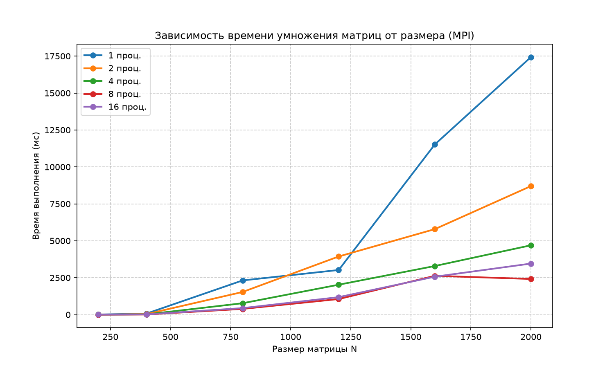
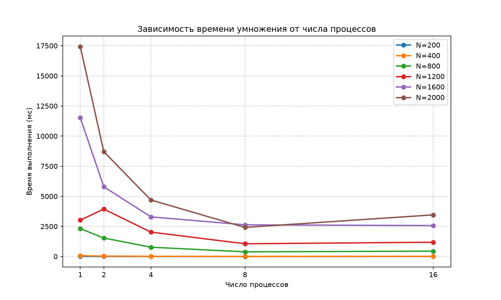
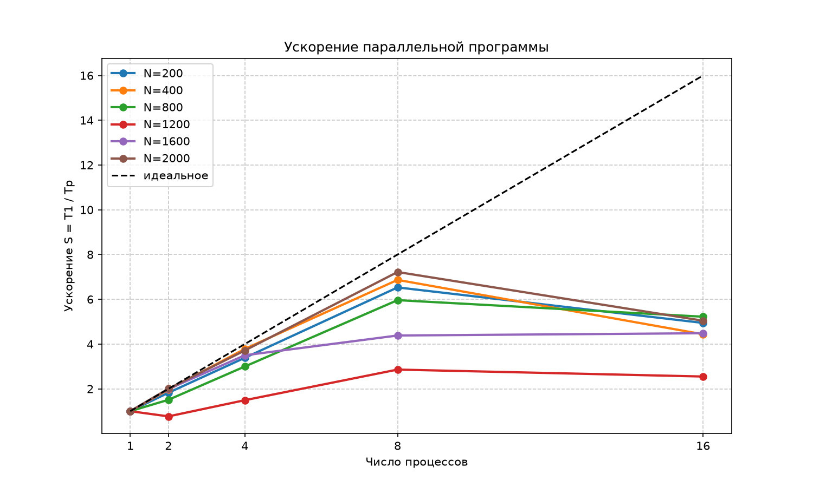
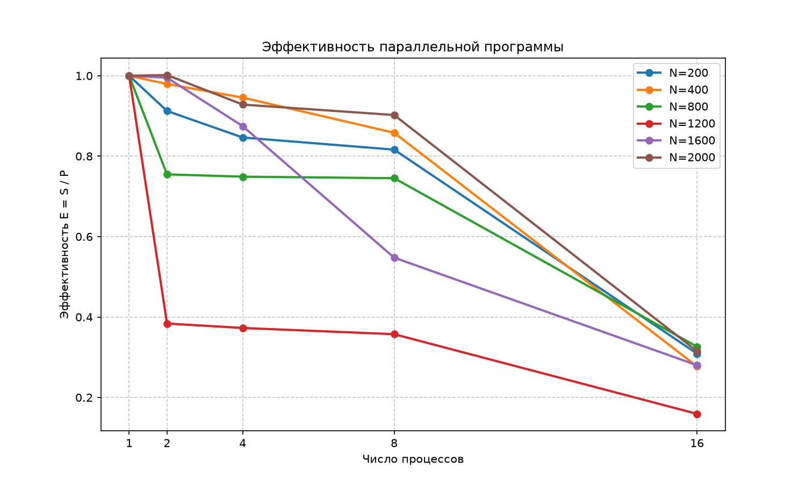

# Отчёт по лабораторной работе №3

**Дисциплина:** Параллельное программирование
**Тема:** Параллельное умножение матриц по технологии MPI
**Выполнила:** Скирдова Дарья Дмитриевна 6213-100503D

---

## 1. Цель работы

Модифицировать программу умножения матриц из лабораторной работы №1 для параллельной работы по технологии MPI, провести серию экспериментов с разными размерами матриц и разным количеством вычислительных ядер и запустить параллельную версию на суперкомпьютере «Сергей Королёв».

## 2. Задание

Модифицировать программу из л/р №1 для параллельной работы по технологии MPI. Провести серию экспериментов с разными размерами матриц (примерно 200, 400, 800, 1200, 1600, 2000) и с разным количеством вычислительных ядер (1, 2, 4, 8 и т.д.). Параллельную версию необходимо запустить на суперкомпьютере «Сергей Королёв».

## 3. Описание реализации

За основу взята последовательная программа из л/р №1: тот же алгоритм умножения (три вложенных цикла i-j-k), те же входные и выходные файлы (`matrix1.txt`, `matrix2.txt`, `result.txt`) и те же элементы типа `int`. Исходный код параллельной версии приведён в приложении.

Использован принцип **декомпозиции по строкам** матрицы A:

1. Процесс 0 читает матрицы A и B из файлов.
2. Размер матрицы N рассылается всем процессам (`MPI_Bcast`).
3. Матрица B целиком рассылается всем процессам (`MPI_Bcast`), так как для вычисления любой строки результата нужны все столбцы B.
4. Строки матрицы A делятся между процессами и раздаются функцией `MPI_Scatterv`. Если N не делится на число процессов P, первые `N mod P` процессов получают на одну строку больше. Использование `Scatterv` и `Gatherv` (а не `Scatter` и `Gather`) позволяет работать с любыми N и P.
5. Каждый процесс вычисляет свой блок строк матрицы C по формуле из л/р №1.
6. Блоки результата собираются на процессе 0 функцией `MPI_Gatherv`, после чего он записывает `result.txt`.

**Замер времени.** Время измеряется функцией `MPI_Wtime` от `MPI_Barrier` до окончания `MPI_Gatherv` и включает рассылку данных, вычисление и сбор результата (чтение и запись файлов не входят). В качестве времени работы программы берётся максимум по всем процессам (`MPI_Reduce` с операцией `MPI_MAX`).

**Проверка корректности.** Результат `result.txt` сравнивался с результатом `numpy.dot` скриптом `verify.py` (как в л/р №1); проверка пройдена.

## 4. Методика экспериментов

- Размеры матриц N: 200, 400, 800, 1200, 1600, 2000.
- Число процессов P: 1, 2, 4, 8, 16 (по одному процессу на ядро).
- Для каждой пары (N, P) программа запускалась 3 раза, в таблицах приведено **среднее время** в миллисекундах.
- Входные матрицы генерируются скриптом `generate.py` (случайные целые числа от 0 до 9), один раз для каждого N.
- Эксперименты автоматизированы скриптом `measure_mpi.py`, запуск на кластере выполнялся через планировщик SLURM (`job.sh`).
- Результаты записываются в `timings.csv`, графики строятся скриптом `plot_mpi.py`.

Метрики:

- Ускорение: **S(P) = T(1) / T(P)**.
- Эффективность: **E(P) = S(P) / P**.

Среда выполнения: суперкомпьютер «Сергей Королёв», компилятор `mpicxx` (флаги `-O2 -std=c++17`). _[При необходимости добавьте: версия компилятора и MPI, число ядер на узле, процессор.]_

## 5. Результаты

### 5.1. Время выполнения, мс

| N \ P | 1 | 2 | 4 | 8 | 16 |
|------:|--------:|--------:|--------:|--------:|--------:|
| 200 | 9.63 | 5.28 | 2.85 | 1.48 | 1.95 |
| 400 | 72.30 | 36.90 | 19.11 | 10.53 | 16.30 |
| 800 | 2316.94 | 1534.95 | 773.31 | 388.62 | 443.73 |
| 1200 | 3023.52 | 3938.20 | 2027.58 | 1057.51 | 1186.16 |
| 1600 | 11522.89 | 5789.48 | 3293.58 | 2629.72 | 2570.19 |
| 2000 | 17437.16 | 8702.96 | 4696.07 | 2415.51 | 3458.02 |

### 5.2. Ускорение S = T(1) / T(P)

| N \ P | 1 | 2 | 4 | 8 | 16 |
|------:|-----:|-----:|-----:|-----:|-----:|
| 200 | 1.00 | 1.82 | 3.39 | 6.53 | 4.94 |
| 400 | 1.00 | 1.96 | 3.78 | 6.87 | 4.44 |
| 800 | 1.00 | 1.51 | 3.00 | 5.96 | 5.22 |
| 1200 | 1.00 | 0.77 | 1.49 | 2.86 | 2.55 |
| 1600 | 1.00 | 1.99 | 3.50 | 4.38 | 4.48 |
| 2000 | 1.00 | 2.00 | 3.71 | 7.22 | 5.04 |

### 5.3. Эффективность E = S / P

| N \ P | 1 | 2 | 4 | 8 | 16 |
|------:|-----:|-----:|-----:|-----:|-----:|
| 200 | 1.00 | 0.91 | 0.85 | 0.82 | 0.31 |
| 400 | 1.00 | 0.98 | 0.95 | 0.86 | 0.28 |
| 800 | 1.00 | 0.75 | 0.75 | 0.75 | 0.33 |
| 1200 | 1.00 | 0.38 | 0.37 | 0.36 | 0.16 |
| 1600 | 1.00 | 1.00 | 0.87 | 0.55 | 0.28 |
| 2000 | 1.00 | 1.00 | 0.93 | 0.90 | 0.32 |

### 5.4. Графики



*Рис. 1. Зависимость времени умножения от размера матрицы N для разного числа процессов.*



*Рис. 2. Зависимость времени умножения от числа процессов для разных N.*



*Рис. 3. Ускорение параллельной программы (пунктир — идеальное ускорение S = P).*



*Рис. 4. Эффективность параллельной программы.*

## 6. Анализ результатов

1. **Рост времени с размером матрицы.** Время растёт примерно кубически, что соответствует сложности алгоритма O(N³). При одном процессе время вычисления выросло с 9.6 мс (N = 200) до 17.4 с (N = 2000).

2. **Ускорение при небольшом числе процессов.** При P = 2 и P = 4 для большинства размеров получено ускорение, близкое к линейному: для N = 2000 ускорение 2.00 при P = 2 и 3.71 при P = 4 (эффективность 1.00 и 0.93), для N = 400 — 1.96 и 3.78. Это объясняется тем, что вычислений много, а накладные расходы на передачу данных малы по сравнению с ними.

3. **Максимальное ускорение.** Наибольшее ускорение 7.22 получено для N = 2000 при P = 8 (эффективность 0.90). Для N = 200 и N = 400 при P = 8 ускорение 6.53 и 6.87.

4. **Деградация при P = 16.** Для всех размеров при переходе от 8 к 16 процессам ускорение не растёт, а для большинства N падает (например, для N = 2000 время выросло с 2416 мс до 3458 мс, ускорение снизилось с 7.22 до 5.04); эффективность падает до 0.16–0.33. Возможные причины: рост доли коммуникаций (матрица B рассылается каждому из 16 процессов, результат собирается на одном процессе), конкуренция процессов за пропускную способность памяти и кэши, а также то, что 16 процессов могут не помещаться на физические ядра одного сокета. Для малых N (200, 400) вычислений слишком мало, и накладные расходы доминируют.

5. **Влияние кэш-памяти.** При одном процессе время растёт быстрее, чем N³: при увеличении N с 400 до 800 число операций возрастает в 8 раз, а время — примерно в 32 раза (72 мс → 2317 мс). Вероятно, это связано с тем, что при N = 400 матрица B помещается в кэш, а при N = 800 уже нет, и обход B по столбцам (`B[k][j]` в цикле по k) становится неэффективным по кэшу. Параллельное выполнение частично снимает эту проблему, так как у каждого процесса остаётся меньший блок A, что отчасти объясняет высокую эффективность на больших N.

6. **Аномалия при N = 1200.** Для N = 1200 результаты выбиваются из общей картины: время на 1 процессе (3023 мс) оказалось ниже ожидаемого при кубическом росте, а на 2 процессах (3938 мс) — даже больше, чем на одном, поэтому ускорение при P = 2 меньше единицы (0.77), а эффективность во всех точках низкая (0.36–0.38). Наиболее вероятные причины — влияние других задач на узле кластера при замере или особенности работы кэша при данном размере; точную причину по имеющимся данным установить нельзя. Для надёжного вывода по этому размеру эксперимент следует повторить большее число раз.

7. **Разброс измерений.** Результат для N = 800 (эффективность 0.75 при P = 2, 4 и 8) и для N = 1600 (падение эффективности до 0.55 при P = 8) также указывает на заметное влияние состояния системы на замеры; число повторов (3) невелико.

## 7. Выводы

1. Программа умножения матриц из л/р №1 модифицирована для параллельной работы по технологии MPI (декомпозиция по строкам матрицы A, рассылка матрицы B, сбор результата), корректность подтверждена сравнением с NumPy.
2. Проведена серия экспериментов для N = 200…2000 и P = 1…16 на суперкомпьютере «Сергей Королёв».
3. При числе процессов от 1 до 8 наблюдается значительное ускорение (до 7.22 раза на 8 процессах для N = 2000), для больших матриц эффективность при P = 2…4 близка к 1.
4. Дальнейшее увеличение числа процессов до 16 эффективности не повышает: рост накладных расходов на коммуникации и ограничения памяти и кэшей приводят к снижению ускорения. Параллелизация оправдана для достаточно больших матриц, а число процессов следует выбирать с учётом размера задачи и архитектуры узла.

---

## Приложение А. Исходный код `lab3.cpp`

```cpp
// Лабораторная работа №3: параллельное умножение матриц по технологии MPI
// Основано на программе из л/р №1 (тот же алгоритм i-j-k, те же файлы ввода/вывода).
//
// Схема распараллеливания:
//   1. Процесс 0 читает matrix1.txt (A) и matrix2.txt (B).
//   2. Матрица B рассылается всем процессам (MPI_Bcast).
//   3. Строки матрицы A раздаются процессам (MPI_Scatterv) - каждый получает
//      свой блок строк (если N не делится на число процессов, часть процессов
//      получает на одну строку больше).
//   4. Каждый процесс считает свой блок строк результата C.
//   5. Блоки собираются на процессе 0 (MPI_Gatherv), он пишет result.txt.
//
// Сборка:  mpicxx -O2 -std=c++17 lab3.cpp -o lab3
// Запуск:  mpirun -np 4 ./lab3

#include <mpi.h>
#include <fstream>
#include <iostream>
#include <vector>
#include <cstdio>

int main(int argc, char** argv) {
    MPI_Init(&argc, &argv);

    int rank = 0, size = 1;
    MPI_Comm_rank(MPI_COMM_WORLD, &rank);
    MPI_Comm_size(MPI_COMM_WORLD, &size);

    int N = 0;
    std::vector<int> A;  // только на процессе 0 (целиком)
    std::vector<int> B;  // на всех процессах (целиком)
    std::vector<int> C;  // только на процессе 0 (целиком)

    // ---------- Чтение данных (процесс 0) ----------
    if (rank == 0) {
        std::ifstream f1("matrix1.txt");
        std::ifstream f2("matrix2.txt");

        if (!f1.is_open() || !f2.is_open()) {
            std::cerr << "Ошибка: не удалось открыть matrix1.txt или matrix2.txt" << std::endl;
            MPI_Abort(MPI_COMM_WORLD, 1);
        }

        f1 >> N;
        f2 >> N;

        A.resize((size_t)N * N);
        B.resize((size_t)N * N);
        C.resize((size_t)N * N, 0);

        for (int i = 0; i < N * N; i++) f1 >> A[i];
        for (int i = 0; i < N * N; i++) f2 >> B[i];
    }

    // Размер матрицы нужен всем
    MPI_Bcast(&N, 1, MPI_INT, 0, MPI_COMM_WORLD);

    if (rank != 0) B.resize((size_t)N * N);

    // ---------- Разбиение строк между процессами ----------
    std::vector<int> sendcounts(size), displs(size);
    int base = N / size, rem = N % size, offset = 0;
    for (int p = 0; p < size; p++) {
        int rows_p = base + (p < rem ? 1 : 0);
        sendcounts[p] = rows_p * N;   // количество элементов, а не строк
        displs[p] = offset;
        offset += sendcounts[p];
    }
    int my_rows = sendcounts[rank] / N;

    std::vector<int> localA((size_t)my_rows * N);
    std::vector<int> localC((size_t)my_rows * N, 0);

    // ---------- Замер времени ----------
    // Измеряем всё параллельное вычисление целиком: рассылка + умножение + сбор
    MPI_Barrier(MPI_COMM_WORLD);
    double start = MPI_Wtime();

    MPI_Bcast(B.data(), N * N, MPI_INT, 0, MPI_COMM_WORLD);

    MPI_Scatterv(A.data(), sendcounts.data(), displs.data(), MPI_INT,
                 localA.data(), sendcounts[rank], MPI_INT,
                 0, MPI_COMM_WORLD);

    // Умножение своего блока строк (алгоритм из л/р №1)
    for (int i = 0; i < my_rows; i++) {
        for (int j = 0; j < N; j++) {
            int sum = 0;
            for (int k = 0; k < N; k++) {
                sum += localA[(size_t)i * N + k] * B[(size_t)k * N + j];
            }
            localC[(size_t)i * N + j] = sum;
        }
    }

    MPI_Gatherv(localC.data(), sendcounts[rank], MPI_INT,
                C.data(), sendcounts.data(), displs.data(), MPI_INT,
                0, MPI_COMM_WORLD);

    double end = MPI_Wtime();
    double local_ms = (end - start) * 1000.0;

    // Время всей программы = время самого медленного процесса
    double time_ms = 0.0;
    MPI_Reduce(&local_ms, &time_ms, 1, MPI_DOUBLE, MPI_MAX, 0, MPI_COMM_WORLD);

    // ---------- Запись результата и вывод (процесс 0) ----------
    if (rank == 0) {
        std::ofstream out("result.txt");
        out << N << '\n';
        for (int i = 0; i < N; i++) {
            for (int j = 0; j < N; j++) {
                out << C[(size_t)i * N + j] << ' ';
            }
            out << '\n';
        }
        out.close();

        std::printf("Размер матрицы: %dx%d\n", N, N);
        std::printf("Число процессов: %d\n", size);
        std::printf("Время умножения: %.3f мс\n", time_ms);
    }

    MPI_Finalize();
    return 0;
}
```
